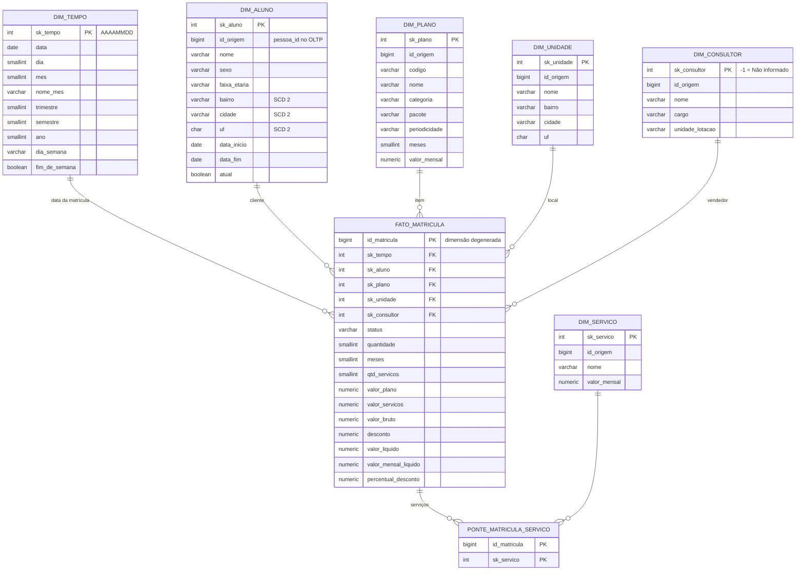

# Modelo estrela (schema `dw`)

**Assunto:** matrículas da rede de academias.
**Granularidade:** uma linha por matrícula (um plano vendido a um aluno, em uma unidade, em uma data).
**Medidas:** quantidade, meses, qtd_servicos, valor_plano, valor_servicos, valor_bruto, desconto, valor_liquido e as derivadas valor_mensal_liquido e percentual_desconto.

