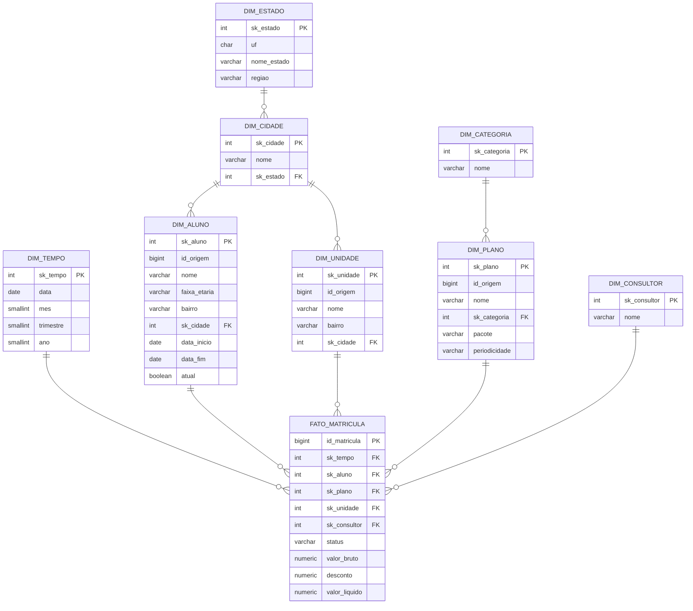

# Modelo floco de neve (schema `dwf`)

Mesmo assunto e mesma granularidade da estrela. Três dimensões foram normalizadas:

- Aluno → Cidade → Estado
- Unidade → Cidade → Estado (Cidade e Estado são compartilhadas)
- Plano → Categoria

As chaves substitutas de aluno, plano, unidade, consultor e tempo são as mesmas da estrela.

**Mesma consulta nos dois modelos** (receita por UF da unidade, categoria e ano):

| Modelo | Tabelas | Junções |
| --- | --- | --- |
| Estrela | fato, tempo, unidade, plano | 3 |
| Floco de neve | fato, tempo, unidade, cidade, estado, plano, categoria | 6 |
